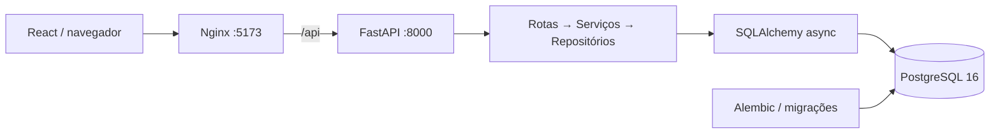

# Entrelinhas · Biblioteca

Projeto Final de C216 — Sistemas Distribuídos, 2026.2.

Aplicação para pequenas bibliotecas acompanharem seu acervo e a circulação dos livros. Integra livros, leitores e empréstimos, com controle de exemplares e histórico de devoluções.

## Funcionalidades

- Livros: criar, consultar, buscar por título/autor/categoria, filtrar, editar e excluir.
- Leitores: cadastro, consulta, busca, edição e exclusão; e-mail único, normalizado em minúsculas.
- Empréstimos: escolher livro disponível, leitor e prazo; registrar devolução; consultar histórico e filtrar por status.
- Disponibilidade calculada pelo total de exemplares menos os empréstimos ativos.
- Prazo vencido identifica automaticamente empréstimos em atraso. A devolução libera o exemplar.
- Bloqueio de empréstimos duplicados para o mesmo leitor/livro e de empréstimos sem exemplares.
- Bloqueio de redução de exemplares abaixo dos empréstimos ativos.
- Livros e leitores com histórico não podem ser excluídos, mesmo após devolução.
- Painel com totais do acervo, exemplares disponíveis, empréstimos ativos e leitores.
- Interface responsiva com estados de carregamento, vazio, sucesso e erro; confirmação de exclusão e devolução.

## Arquitetura e tecnologias



Backend: Python 3.12, Poetry, FastAPI, Pydantic, SQLAlchemy, asyncpg, Alembic, Pytest e Ruff. Frontend: JavaScript, React, Vite, Biome, Vitest, Testing Library e Playwright. Infraestrutura: Docker Compose e GitHub Actions.

O navegador utiliza `/api` na mesma origem; Nginx encaminha ao serviço `api`. No desenvolvimento, o proxy do Vite faz esse encaminhamento. A API também permite acesso direto das origens configuradas em `CORS_ORIGINS`.

A criação de empréstimos bloqueia a linha do livro (`SELECT FOR UPDATE`) dentro da transação PostgreSQL. Isso serializa a disputa pelo último exemplar. Restrições de integridade e índice único parcial reforçam as regras no banco. As migrações executam antes de iniciar a API; o healthcheck consulta o banco. Os dados ficam em volume nomeado.

```text
backend/
  app/
    core/          configuração por ambiente
    database/      engine e sessão transacional
    models/        entidades e restrições SQLAlchemy
    schemas/       entrada e saída Pydantic
    repositories/  consultas e persistência
    services/      regras de circulação
    routes/        endpoints HTTP
  alembic/         migrações versionadas
  tests/           regras, endpoints, migrações e concorrência
frontend/
  src/             interface React, modal e cliente HTTP
  tests/           Vitest/Testing Library e E2E Playwright
scripts/e2e.sh     ambiente integrado isolado e limpeza
.github/workflows/ci.yml
```

## Executar com Docker

Pré-requisitos: Git, Docker Engine/Desktop em execução e Docker Compose v2 com suporte a `--wait`. Make é usado como atalho. Para testes do frontend no host: Node.js 24 e npm. Para desenvolvimento Python local: Python 3.12 e Poetry 2.

```bash
git clone https://github.com/PauloVporto/C216.git
cd C216
git switch projeto-final
cp .env.example .env
make up
```

- Aplicação: http://localhost:5173
- Swagger/OpenAPI: http://localhost:8000/docs
- Saúde da API/banco: http://localhost:8000/health

A primeira execução instala dependências, constrói as imagens, inicia PostgreSQL, aplica a migração e inicia API e frontend, nessa ordem. O acervo começa vazio: adicione livros e leitores pela interface antes de registrar um empréstimo.

Se a porta 5173 estiver ocupada, use `FRONTEND_PORT=5174 make up` e acesse http://localhost:5174. O proxy continua funcionando. Para acesso direto à API dessa origem, adicione-a em `CORS_ORIGINS`.

```bash
make status          # saúde dos serviços
make logs            # acompanhar logs (Ctrl+C para sair)
make migrate         # reaplicar upgrade head, sem apagar dados
make db-shell        # psql; use \dt para listar tabelas e \q para sair
make down            # parar contêineres, preservando o volume
make up              # iniciar novamente com os mesmos dados
```

Para comprovar persistência: cadastre um livro, recarregue a página e execute `make down` / `make up`. O livro continua no acervo. Não remova o volume `postgres_data` se quiser preservar os cadastros.

## Variáveis de ambiente

Use `.env.example` como referência. `.env` não é versionado. As credenciais de exemplo são somente de desenvolvimento local.

| Variável | Padrão / uso |
| --- | --- |
| `POSTGRES_DB` | `biblioteca` |
| `POSTGRES_USER` | `biblioteca` |
| `POSTGRES_PASSWORD` | `biblioteca`; altere em ambientes compartilhados |
| `DB_PORT` | `5432`, publicado apenas em `127.0.0.1` |
| `API_PORT` | `8000` no host |
| `FRONTEND_PORT` | `5173` no host |
| `DATABASE_URL` | conexão async SQLAlchemy para execução local; Compose monta a URL com host `db` |
| `CORS_ORIGINS` | origens permitidas separadas por vírgulas, sem barra final |
| `VITE_API_URL` | opcional, endereço público da API; vazio usa proxy `/api` |
| `API_PROXY_TARGET` | somente Vite: `http://localhost:8000` por padrão |
| `TEST_DATABASE_URL` | banco exclusivo dos testes; ausente utiliza SQLite temporário |

`VITE_API_URL` é configuração de build do Vite para desenvolvimento local. No Docker, o frontend usa o proxy Nginx sem necessidade de expor o hostname interno ao navegador. Não coloque segredos em variáveis `VITE_*`.

## Desenvolvimento local

```bash
make install
# Terminal 1, PostgreSQL via Docker:
docker compose up -d --wait db
cd backend
poetry run alembic upgrade head
poetry run uvicorn app.main:app --reload
# Terminal 2:
cd frontend
npm run dev
```

O backend carrega o `.env` da raiz via python-dotenv. Alterações no modelo exigem migração versionada:

```bash
cd backend
poetry run alembic revision --autogenerate -m "descreve alteracao"
# Revise o arquivo gerado antes de aplicar.
poetry run alembic upgrade head
```

## Testes e qualidade

```bash
make install
make lint             # Ruff check/format e Biome check
make test             # Pytest em PostgreSQL isolado + Vitest no host
make check            # lint, testes e build de produção
cd frontend && npx playwright install chromium && cd ..
make e2e              # navegador + frontend + API + PostgreSQL reais
```

`make test-backend` usa o serviço `db-test`, sem acessar o banco da aplicação. Os testes limpam esse banco dedicado entre casos. `make test-frontend` executa Vitest/Testing Library. Para validar sem Docker: `cd backend && poetry run pytest -q`; usa SQLite temporário e pula apenas o teste que exige bloqueios de PostgreSQL.

O E2E cria o projeto Compose `c216-entrelinhas-e2e`, com banco/volume próprios, usando portas 5180 (frontend), 8180 (API) e 55433 (banco). Ao terminar, remove apenas os contêineres e volumes desse projeto. Não usa o acervo de desenvolvimento. Caso necessário, ajuste `E2E_FRONTEND_PORT`, `E2E_API_PORT` e `E2E_DB_PORT`.

Cobertura funcional: regras de estoque/prazos/status, validação, CRUD e erros HTTP, CORS, upgrade/downgrade de migrações, disputa simultânea pelo último exemplar; formulários, busca/filtros e erros no React; dois E2E com persistência após reload, edição, exclusão, empréstimo e devolução.

O workflow **Projeto final** executa três jobs: backend com PostgreSQL, frontend com lint/testes/build e E2E com Compose. Dispara em push para `projeto-final`, `main` ou `Main`, e em PR para `main`/`Main`, sem filtros que omitam alguma parte da aplicação. Traces do Playwright são anexados em caso de falha.

## API

| Método | Rota | Operação |
| --- | --- | --- |
| GET / POST | `/api/books` | listar / criar livros |
| PUT / DELETE | `/api/books/{id}` | editar / excluir livro |
| GET / POST | `/api/readers` | listar / criar leitores |
| PUT / DELETE | `/api/readers/{id}` | editar / excluir leitor |
| GET / POST | `/api/loans` | histórico / novo empréstimo |
| POST | `/api/loans/{id}/return` | devolver exemplar |
| GET | `/health` | verificar conexão com banco |

Respostas: `201` para criação, `204` para exclusão, `404` para registro inexistente, `409` para conflito de negócio/integridade e `422` para dados inválidos. Os contratos completos estão em `/docs`.

## Entrega e vídeo

Branch de entrega: `projeto-final`. A branch principal deste repositório se chama **`Main`** (M maiúsculo), por isso o PR usa `projeto-final → Main`. O PR deve permanecer aberto, sem merge.

**Vídeo demonstrativo: pendente de gravação e publicação pelo aluno.** Substitua esta linha pelo link acessível antes da entrega. A narração própria do aluno é exigida no enunciado. A duração recomendada é de 5–10 minutos, demonstrando a aplicação real em funcionamento.

Até **28/11/2026**, envie na atividade do Teams o link deste repositório, do PR aberto com os Checks aprovados e do vídeo. Confirme que os avaliadores conseguem acessar todos os links.

A implementação foi desenvolvida com apoio de IA. O aluno deve revisar o código, executar os comandos, compreender as regras e a arquitetura, realizar sua própria demonstração e concluir o vídeo e a entrega. Consulte o [guia de revisão](docs/revisao.md).

Limites do escopo: aplicação acadêmica sem autenticação; operações disponíveis a quem tiver acesso à API. O histórico de empréstimos é preservado e não possui exclusão pela interface. Não há publicação em nuvem: a entrega usa a stack Docker/PostgreSQL pedida na disciplina.
