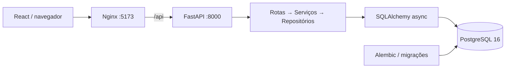

# LocaPlay · Aluguel de jogos

Projeto Final de C216 — Sistemas Distribuídos, 2026.2.

Aplicação para locadoras de jogos físicos organizarem o catálogo por plataforma, cadastrarem clientes e controlarem locações, disponibilidade e valores de diárias. O fluxo integra React, FastAPI e PostgreSQL: do cadastro do jogo ao fechamento da locação na devolução.

## Funcionalidades

- Jogos: criar, consultar, buscar por título/plataforma/gênero, filtrar por gênero, editar e excluir.
- Catálogo com plataforma, gênero, número de cópias e valor da diária em reais. Plataformas aceitas: PS5, PS4, Xbox Series, Xbox One, Nintendo Switch e PC.
- Clientes: cadastro, consulta, busca por nome/e-mail, edição e exclusão; e-mail único e normalizado.
- Locações: selecionar jogo disponível, cliente e data de devolução; consultar estimativa antes de registrar; devolver e consultar histórico e total.
- Disponibilidade calculada por jogo/plataforma: cópias cadastradas menos locações ainda abertas.
- Diária contratada preservada na locação: mudar o preço do catálogo afeta apenas novas locações.
- Total calculado em centavos, com período reservado, mínimo de uma diária e acréscimo por dias de atraso.
- Devolução libera a cópia e persiste o total final. Locações encerradas deixam de acumular diárias.
- Bloqueio de locação duplicada do mesmo jogo para o mesmo cliente e de locação sem cópias disponíveis.
- Bloqueio de redução do estoque abaixo das locações ativas e de exclusão de cadastros com histórico.
- Indicadores de jogos, cópias disponíveis, locações ativas e soma dos valores das locações encerradas.
- Interface responsiva com carregamento, estados vazios, sucesso e erros, filtros e confirmações.

## Regras de cobrança

As datas usam o fuso `America/Sao_Paulo`. A diária usa **dias corridos**, sem fracionamento por hora:

```text
dias reservados = máximo entre 1 e (devolução prevista − início)
dias em atraso = máximo entre 0 e (data de devolução − devolução prevista)
total = (dias reservados + dias em atraso) × diária contratada
```

O período reservado é cobrado integralmente mesmo na devolução antecipada. Na lista de locações abertas, a data atual substitui a data de devolução para mostrar o total até hoje. Ao devolver, o servidor calcula e grava o total definitivo.

Exemplo: diária de **R$ 12,99**, retirada em **17/11**, prazo em **20/11**: três diárias, **R$ 38,97**. Devolução em **22/11** acrescenta dois dias: cinco diárias, **R$ 64,95**. Alterar depois o catálogo para R$ 20,00 não muda a diária desse contrato.

Os valores são calculados para controle da locadora. Não há processamento de pagamentos, confirmação de recebimento nem emissão fiscal. A soma de locações encerradas não representa recebimentos bancários confirmados.

## Arquitetura e tecnologias



Backend: Python 3.12, Poetry, FastAPI, Pydantic, SQLAlchemy, asyncpg, Alembic, Pytest e Ruff. Frontend: JavaScript, React, Vite, Biome, Vitest, Testing Library e Playwright. Infraestrutura: Docker Compose e GitHub Actions.

O navegador acessa `/api` na mesma origem; Nginx encaminha as requisições ao serviço `api`. No desenvolvimento local, o proxy do Vite faz esse encaminhamento. O acesso direto à API respeita `CORS_ORIGINS`.

Cada requisição de escrita usa uma transação SQLAlchemy. A locação bloqueia a linha do jogo (`SELECT FOR UPDATE`) antes de conferir o estoque, evitando que dois clientes aluguem a mesma última cópia. Um índice único parcial impede contratos ativos duplicados. As migrações executam antes de iniciar a API; o healthcheck consulta o banco e os dados ficam em volume nomeado.

```text
backend/
  app/
    core/          configuração por ambiente
    database/      engine e sessão transacional
    models/        jogos, clientes e locações; modelos legados preservados
    schemas/       contratos e validação de entrada/saída
    repositories/  consultas e persistência
    services/      estoque, preço contratado, prazos e fechamento
    routes/        endpoints REST
  alembic/         migrações versionadas 001 e 002
  tests/           regras, endpoints, migrações e concorrência
frontend/
  src/             catálogo, clientes, locações, modal e cliente HTTP
  tests/           componentes, orçamento e E2E Playwright
scripts/e2e.sh     stack isolada para testes e limpeza
.github/workflows/ci.yml
```

## Executar com Docker

Pré-requisitos: Git, Docker Engine/Desktop em execução e Docker Compose v2 com suporte a `--wait`. Make é usado como atalho. Para testes do frontend no host: Node.js 24 e npm. Para desenvolvimento Python local: Python 3.12 e Poetry 2.

```bash
git clone https://github.com/PauloVporto/C216.git
cd C216
git switch projeto-final
cp .env.example .env
make up
```

- Aplicação: http://localhost:5173
- Swagger/OpenAPI: http://localhost:8000/docs
- Saúde da API/banco: http://localhost:8000/health

A primeira execução instala dependências, constrói imagens, inicia PostgreSQL, aplica as migrações e inicia API e frontend. O catálogo começa vazio. Cadastre um jogo com plataforma, gênero, cópias e diária; depois cadastre um cliente e registre uma locação.

Se a porta 5173 estiver ocupada, use `FRONTEND_PORT=5174 make up` e acesse http://localhost:5174. O proxy continua funcionando. Para acesso direto à API dessa origem, adicione-a em `CORS_ORIGINS`.

```bash
make status          # saúde dos serviços
make logs            # acompanhar logs (Ctrl+C para sair)
make migrate         # alembic upgrade head, sem apagar os cadastros
make db-shell        # psql; \dt lista tabelas, \q sai
make down            # parar os contêineres, preservando o volume
make up              # iniciar novamente com os mesmos dados
```

Para comprovar persistência, cadastre um jogo, recarregue a página e execute `make down` / `make up`. O cadastro continua disponível. Não remova o volume `postgres_data` se quiser preservar os dados.

## Variáveis de ambiente

Use `.env.example` como referência. `.env` não é versionado. As credenciais de exemplo servem somente ao desenvolvimento local.

| Variável | Padrão / uso |
| --- | --- |
| `POSTGRES_DB` | `locaplay` |
| `POSTGRES_USER` | `locaplay` |
| `POSTGRES_PASSWORD` | `locaplay`; altere em ambientes compartilhados |
| `DB_PORT` | `5432`, publicado apenas em `127.0.0.1` |
| `API_PORT` | `8000` no host |
| `FRONTEND_PORT` | `5173` no host |
| `DATABASE_URL` | conexão async SQLAlchemy local; Compose usa o hostname interno `db` |
| `CORS_ORIGINS` | origens permitidas separadas por vírgulas, sem barra final |
| `VITE_API_URL` | opcional no build Vite; vazio utiliza o proxy `/api` |
| `API_PROXY_TARGET` | somente Vite: `http://localhost:8000` por padrão |
| `TEST_DATABASE_URL` | banco exclusivo dos testes; ausente utiliza SQLite temporário |

Não coloque segredos em variáveis `VITE_*`. O frontend Docker usa o proxy Nginx e não precisa conhecer o endereço interno do banco ou da API.

## Desenvolvimento local e migrações

```bash
make install
# Terminal 1, PostgreSQL via Docker:
docker compose up -d --wait db
cd backend
poetry run alembic upgrade head
poetry run uvicorn app.main:app --reload
# Terminal 2:
cd frontend
npm run dev
```

O backend carrega o `.env` da raiz via python-dotenv. Mudanças de modelos exigem migração:

```bash
cd backend
poetry run alembic revision --autogenerate -m "descreve alteracao"
# Revise a migração gerada antes de aplicar.
poetry run alembic upgrade head
```

O projeto evoluiu de biblioteca para locadora. A migração `001_library` permanece no histórico; `002_game_rentals` cria `games`, `customers` e `rentals` sem converter livros em jogos nem apagar registros antigos. As tabelas antigas são preservadas e não são expostas pela API ou interface atuais. O teste de migração comprova a preservação no upgrade e no downgrade da revisão 002.

O Compose atual usa o projeto `c216-locaplay` e seu próprio volume. Volumes da versão anterior não são removidos. Ao reaproveitar explicitamente um banco antigo via `DATABASE_URL`, execute `alembic upgrade head` antes de iniciar a API nova.

## Testes e qualidade

```bash
make install
make lint             # Ruff check/format e Biome check
make test             # Pytest/PostgreSQL e Vitest
make check            # lint, testes e build de produção
cd frontend && npx playwright install chromium && cd ..
make e2e              # navegador + frontend + API + PostgreSQL reais
```

`make test-backend` usa o banco dedicado `db-test`; os testes limpam esse banco entre cenários. `make test-frontend` executa Vitest/Testing Library. Sem Docker: `cd backend && poetry run pytest -q` usa SQLite temporário e pula apenas o teste que depende dos bloqueios PostgreSQL.

O E2E usa o projeto `c216-locaplay-e2e`, com banco e volume próprios e portas 5180 (frontend), 8180 (API) e 55433 (banco). Remove somente esses recursos ao terminar. É possível ajustar `E2E_FRONTEND_PORT`, `E2E_API_PORT` e `E2E_DB_PORT`.

Os testes cobrem estoque, prazos, validação, CRUD, CORS, migrações e concorrência; diária mínima, reserva integral, atraso, preço contratado e total encerrado; formulários, filtros e orçamento no React; dois E2E com persistência, CRUD, locação, alteração posterior do preço e devolução.

O workflow **Projeto final** executa os jobs `backend`, `frontend` e `e2e`, em pushes para `projeto-final`, `main` ou `Main` e em PRs para `main`/`Main`, sem filtros de arquivos. Traces do Playwright são anexados em caso de falha.

## API

| Método | Rota | Operação |
| --- | --- | --- |
| GET / POST | `/api/games` | listar / cadastrar jogos |
| PUT / DELETE | `/api/games/{id}` | editar / excluir jogo |
| GET / POST | `/api/customers` | listar / cadastrar clientes |
| PUT / DELETE | `/api/customers/{id}` | editar / excluir cliente |
| GET / POST | `/api/rentals` | histórico e valores / nova locação |
| POST | `/api/rentals/{id}/return` | registrar devolução e fixar total |
| GET | `/health` | verificar acesso ao banco |

Preços da API são inteiros em centavos: `daily_rate_cents`, `estimated_total_cents` e `total_cents`. A interface converte entrada e apresentação para reais. O cliente não envia o total nem a diária contratada ao abrir uma locação: esses valores vêm do servidor.

Respostas: `201` para criação, `204` para exclusão, `404` para registro inexistente, `409` para conflito de negócio/integridade e `422` para entrada inválida. Contratos completos em `/docs`.

## Entrega e vídeo

Branch: `projeto-final`. A branch principal existente é **`Main`**, com M maiúsculo. O [PR final #9](https://github.com/PauloVporto/C216/pull/9) deve permanecer aberto, sem merge, com os Checks aprovados.

**Vídeo demonstrativo:** [Assistir à demonstração do LocaPlay no Microsoft Stream](https://posinatel-my.sharepoint.com/:v:/r/personal/paulo_v_gec_inatel_br/_layouts/15/stream.aspx?id=%2Fpersonal%2Fpaulo_v_gec_inatel_br%2FDocuments%2FVideoC216%2F2026-11-21%2011-12-46.mov&nav=eyJyZWZlcnJhbEluZm8iOnsicmVmZXJyYWxBcHAiOiJPbmVEcml2ZUZvckJ1c2luZXNzIiwicmVmZXJyYWxBcHBQbGF0Zm9ybSI6IldlYiIsInJlZmVycmFsTW9kZSI6InZpZXciLCJyZWZlcnJhbFZpZXciOiJNeUZpbGVzTGlua0NvcHkifX0&share=cQoOMOK1i76ZQZ3QP0BmbuatEgUCooj-8DQ1my3P2scr2O1FYQ).

Caso o link principal não funcione, utilize o [link alternativo do vídeo no Google Drive](https://drive.google.com/file/d/1adPUP4bODHm10FM4LdxZJbCUBETjhbim/view?usp=sharing).

Até **28/11/2026**, envie na atividade do Teams os links do repositório, do PR e do vídeo. Confira o acesso dos avaliadores.

A implementação contou com apoio de IA. O aluno deve revisar o código, executar os comandos, compreender as regras e realizar a própria demonstração. O [guia de revisão](docs/revisao.md) indica os pontos técnicos a estudar.

Limites: aplicação acadêmica sem autenticação; a API fica disponível a quem tiver acesso à rede. O histórico de locações não tem exclusão pela interface. Não há pagamento online nem deploy em nuvem; a execução integrada utiliza Docker e PostgreSQL.
