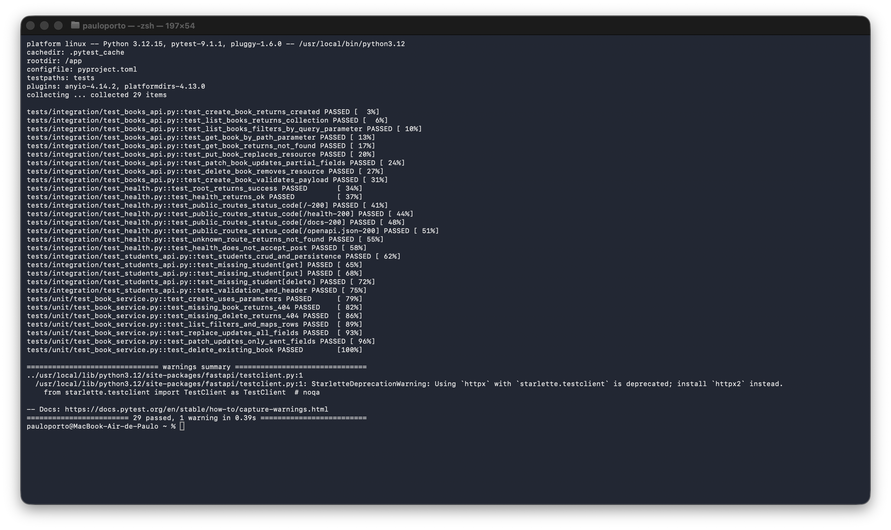
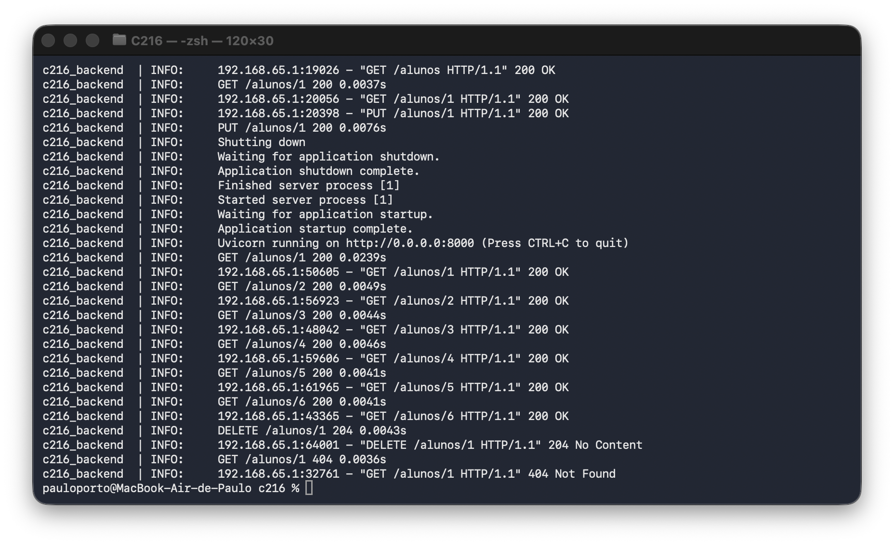
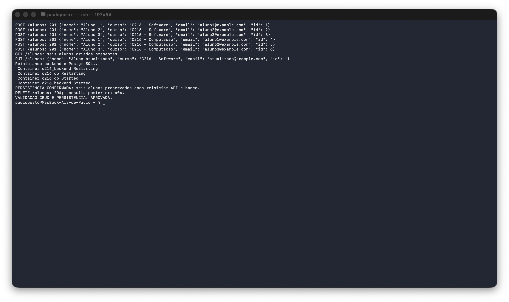

# Evidências da prática 5

Validação executada em 13/10/2026 com API FastAPI e PostgreSQL 16 no Docker Compose.

## Resultados dos testes

A suíte completa executada com `docker compose run --build --rm tests` passou:
**29 testes aprovados**, sendo 7 unitários e 22 de integração.
O teste de alunos cadastra três alunos por curso em dois cursos e valida
listagem, filtro por curso, busca por ID, atualização, remoção e persistência.

## Logs do container

Chamadas reais à API, com método, caminho, status e duração registrados
pelo middleware, incluindo atualização, consulta após reinício e remoção.

## Persistência entre reinícios

Foram criados seis alunos pela API, três em cada um de dois cursos.
Um aluno foi atualizado; em seguida, `docker compose restart backend db`
reiniciou a API e o PostgreSQL. As consultas recuperaram os seis registros
com os mesmos IDs e dados, inclusive a atualização. A remoção retornou 204
e a consulta posterior retornou 404.

As saídas de texto também estão disponíveis em `testes.txt`, `logs-api.txt`
e `persistencia.txt`. Os dados da API ficam no volume persistente; a suíte
usa um PostgreSQL separado e não limpa os registros da API.
