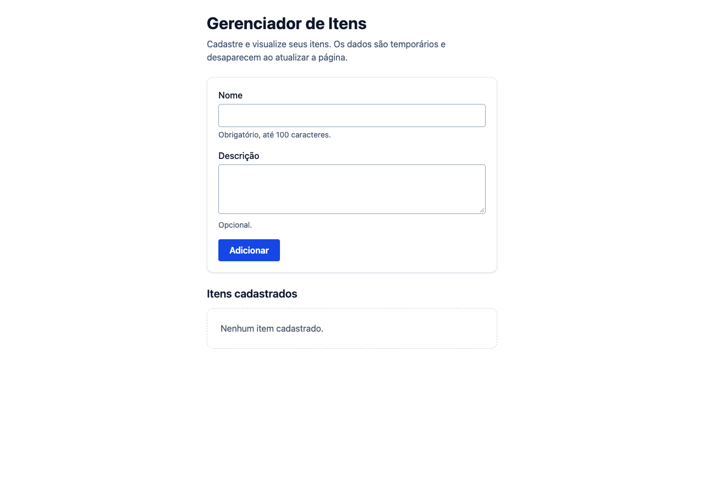
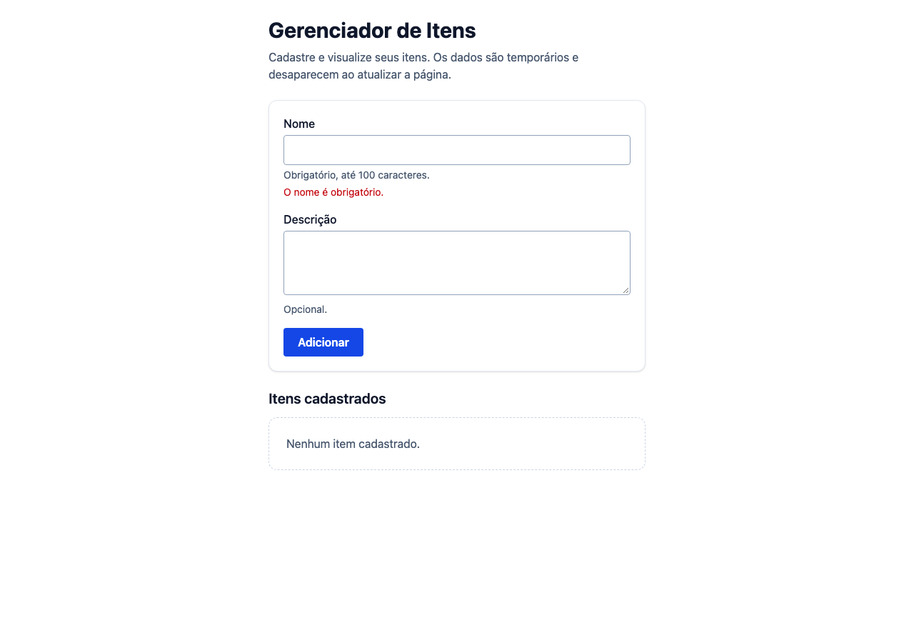
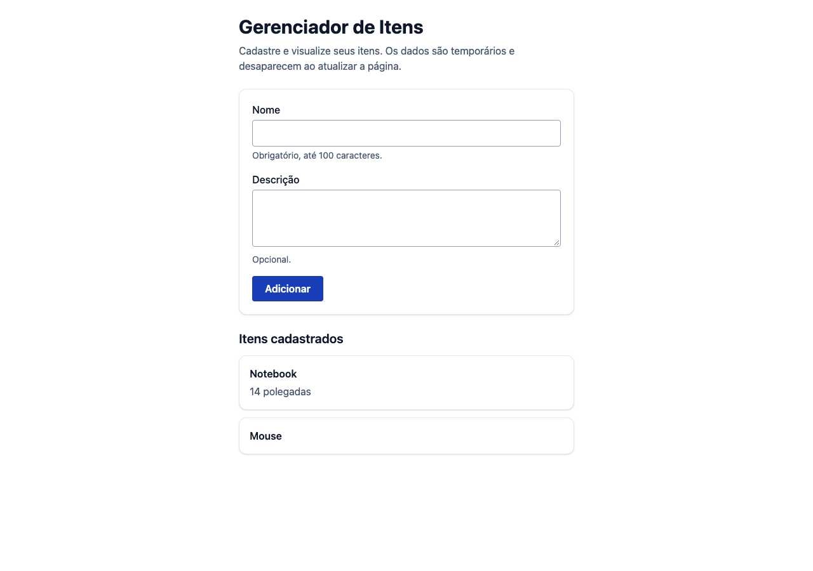
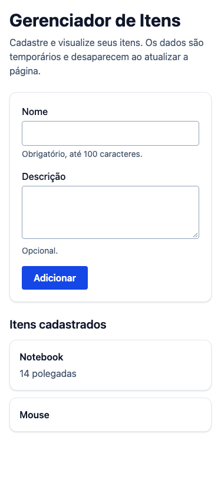

# Evidências da prática 6

Validação local em 25/10/2026: instalação com `npm ci`, lint, formatação,
verificação de imports, build e **14 testes aprovados**: 9 unitários,
2 de integração e 3 E2E no Chromium. A saída real do Playwright está em
[e2e.txt](e2e.txt). O resultado remoto da CI pode ser consultado no PR.

Os testes cobrem nome obrigatório e limite de 100 caracteres, normalização,
descrição opcional, componentes isolados, cadastro integrado, limpeza de campos,
múltiplos itens, ausência de chamadas fetch/XHR e perda dos dados após recarregar.
O cenário mobile usa 375 × 812 pixels e verifica ausência de rolagem horizontal.

## Estado vazio

## Validação do nome obrigatório

## Cadastro com e sem descrição

## Interface mobile

As capturas foram geradas no navegador real com Playwright, a partir da aplicação local.
